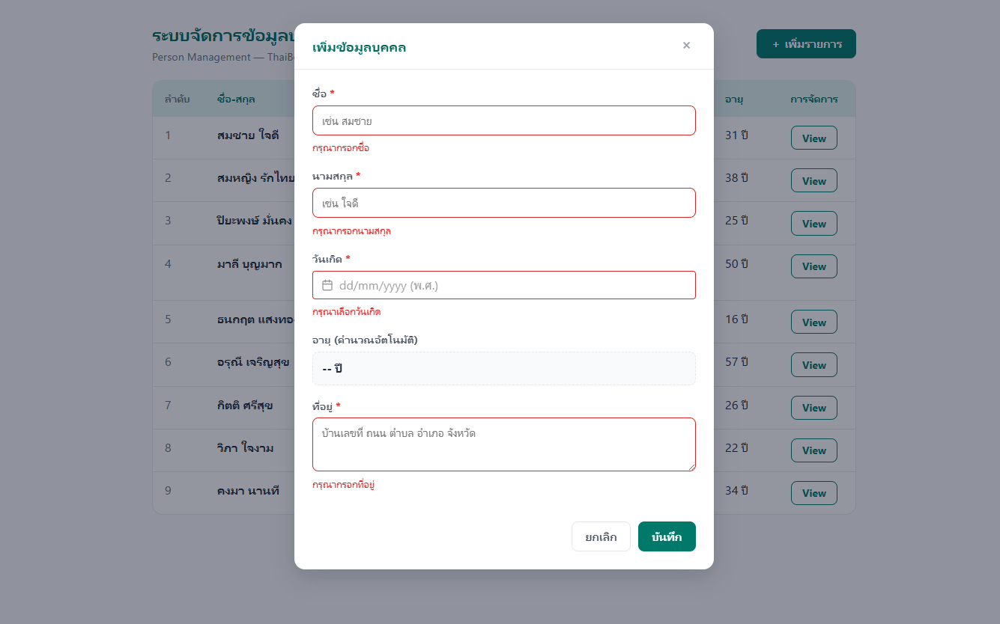

# ThaiBev IT Assignment — Person Management

ระบบจัดการข้อมูลบุคคล 3 หน้าจอ (IT 01-1 List, IT 01-2 Add modal, IT 01-3 View modal)
ตามโจทย์: อายุ = ปีปัจจุบัน − ปีเกิด และแสดงผล **ปี พ.ศ.**

**Stack:** SQL Server (Docker) · C# .NET 10 Web API (EF Core) · Vue 3 + TypeScript + Vite

```
thaibev-assignment/
├── backend/
│   ├── ThaiBev.PersonApi/          # Web API
│   │   ├── Controllers/PersonsController.cs
│   │   ├── Services/               # PersonService, AgeCalculator, exception handler
│   │   ├── Data/                   # AppDbContext, DbInitializer (migration + seed)
│   │   ├── Entities/  Dtos/
│   │   └── Migrations/             # EF migration (InitialCreate)
│   └── ThaiBev.PersonApi.Tests/    # xUnit: AgeCalculatorTests, PersonServiceTests
├── frontend/                       # Vue 3 + Vite + TS
│   └── src/
│       ├── api/personApi.ts        # axios client (/api → proxy ไป :5000)
│       ├── utils/buddhistDate.ts   # แปลง พ.ศ./ค.ศ., format dd/mm/yyyy พ.ศ., คำนวณอายุ
│       ├── components/             # PersonTable (01-1), PersonFormModal (01-2), PersonViewModal (01-3)
│       ├── composables/usePersons.ts
│       └── views/PersonListView.vue
└── database/
    ├── docker-compose.yml          # SQL Server 2022 container (port 1433)
    ├── 01_create_schema.sql        # สร้าง DB + ตาราง Person (สำรองไว้ใช้นอกเหนือจาก EF migration)
    └── 02_seed.sql                 # ข้อมูลตัวอย่าง 8 รายการ
```

## Screenshots

| IT 01-1 — หน้ารายการ | IT 01-2 — เพิ่มข้อมูล | IT 01-3 — ดูรายละเอียด |
|---|---|---|
|  |  |  |

## สิ่งที่ต้องติดตั้ง

| เครื่องมือ | เวอร์ชันที่ใช้พัฒนา |
|---|---|
| .NET SDK | 10.0 (`dotnet --list-sdks`) |
| Node.js | 24.x (npm 11) |
| SQL Server | ผ่าน Docker (`docker-compose`) |
| Docker Desktop | ใช้ Docker รัน SQL Server |

## วิธีรัน (3 ส่วน)

### 1) SQL Server

```bash
cd database
docker compose up -d          # SQL Server 2022 ที่ localhost:1433
docker compose ps             # รอ status = healthy (~30 วินาทีแรก)
```

- SA password: `Th@iBev2026!Sql`
- ถ้าใช้ SQL Server อื่น (LocalDB / Express / เครื่อง server): ข้ามขั้นตอนนี้ แล้วไปแก้ connection string ในข้อ 2

### 2) Backend API

**ตั้ง connection string** (มีค่า default สำหรับ Docker ไว้แล้วใน `appsettings.Development.json`):

```json
"ConnectionStrings": {
  "Default": "Server=localhost,1433;Database=ThaiBevAssignment;User Id=sa;Password=Th@iBev2026!Sql;Encrypt=True;TrustServerCertificate=True"
}
```

- แนะนำให้ override ด้วย **user-secrets** แทนการแก้ไฟล์: `dotnet user-secrets set "ConnectionStrings:Default" "..."` (รันในโฟลเดอร์ `backend/ThaiBev.PersonApi`)
- ใช้ user/password ของ SQL Server ที่ท่านจัดเตรียม

**รัน API:**

```bash
cd backend/ThaiBev.PersonApi
dotnet run
# → http://localhost:5000
# Swagger UI: http://localhost:5000/swagger (เฉพาะ Development)
```

ตอน startup API จะ:
1. Apply EF migration (`InitialCreate`) สร้าง DB + ตาราง `Person` ให้เอง — **ไม่ต้องรัน SQL script เอง**
   (ถ้าสร้างตารางจาก `database/01_create_schema.sql` ไปก่อนแล้ว API จะตรวจและข้าม migration ให้เอง)
2. Seed ข้อมูลตัวอย่าง 8 รายการ ถ้าตารางยังว่าง (ชุดเดียวกับ `database/02_seed.sql`)

**ทดสอบ API เร็ว ๆ:**

```bash
curl http://localhost:5000/api/persons
```

### 3) Frontend

```bash
cd frontend
npm install
npm run dev
# → http://localhost:5173 (proxy /api → http://localhost:5000 ให้เอง)
```

## การทำงานของระบบ

### เกี่ยวกับ ปี พ.ศ.
- DB และ API จัดเก็บ/ส่งเป็น **ค.ศ.** รูปแบบ ISO `yyyy-MM-dd` (DATE / `DateOnly`) — ถูกต้องต่อการ sort และ validate
- แปลงเป็น พ.ศ. **เฉพาะที่ UI** (`frontend/src/utils/buddhistDate.ts`): แสดง `dd/mm/yyyy` พ.ศ. และ date picker (วันเกิดใน IT 01-2) แสดงเดือนไทย + ปี พ.ศ. ทั้ง header และช่อง input
- อายุ = ปีปัจจุบัน − ปีเกิด ตามโจทย์ (ไม่ใช่อายุเต็มปี) — คำนวณฝั่ง API ตอนอ่าน (`Services/AgeCalculator.cs`) ไม่เก็บลง DB
- เวลา "ปัจจุบัน" อ้าง timezone `Asia/Bangkok` ก่อนดึงปี เพื่อกันกรณี server เป็น UTC คืนวันที่ 31 ธ.ค.

### API (base: `/api/persons`)

| Method | Path | คำอธิบาย | Response |
|---|---|---|---|
| GET | `/api/persons` | รายการทั้งหมด เรียง `Id ASC` (ข้อมูลใหม่อยู่ท้าย) | 200 `PersonListItem[]` |
| GET | `/api/persons/{id}` | รายละเอียดสำหรับ View modal | 200 `PersonDetail` / 404 |
| POST | `/api/persons` | เพิ่มข้อมูลใหม่ | 201 + `Location` header / 400 |

- Validation ทั้งจาก DataAnnotations ของ DTO และใน service (วันเกิดห้ามอนาคต / เก่าเกิน 150 ปี / trim ช่องว่าง) คืนเป็น `ValidationProblemDetails`
- Error ที่ไม่คาดคิดคืน 500 เป็น `ProblemDetails` โดยไม่เปิดเผย stack trace (global `IExceptionHandler`)

### UI พฤติกรรมสำคัญ
- **ยกเลิก / Esc / คลิกนอก modal** → ปิดโดยไม่เรียก API และไม่บันทึกอะไรลง DB เปิดใหม่ฟอร์มว่างเสมอ
- อายุใน Add modal ขึ้น `-- ปี` จนกว่าเลือกวันเกิด แล้วคำนวณสดทันที
- ปุ่ม บันทึก disable ระหว่างส่ง กันกดซ้ำเกิด 2 แถว
- View modal เป็น read-only ทุกช่อง (เรียก `GET /{id}` ทุกครั้งที่เปิด) มีเฉพาะปุ่ม ปิด
- มี loading / empty state ("ยังไม่มีข้อมูล") / error ภาษาไทยเมื่อ API ล้มเหลว พร้อมปุ่มลองใหม่

## รัน Unit Test

```bash
cd backend
dotnet test          # 21 tests: AgeCalculator (leap day, edge case ขึ้นปีใหม่, พ.ศ.-ค.ศ.) + PersonService (validation, ordering, trim)
```

## หมายเหตุ
- CORS เปิดเฉพาะ `http://localhost:5173` (Vue dev server)
- เชื่อมต่อผ่าน Vite proxy `/api` → `:5000` ใน dev จึงไม่โดน CORS แต่ API ก็เปิด CORS ไว้ให้เรียบร้อย
- ห้ามใช้ `v-html` กับข้อมูลจาก user (XSS) — Vue escape ให้โดย default
