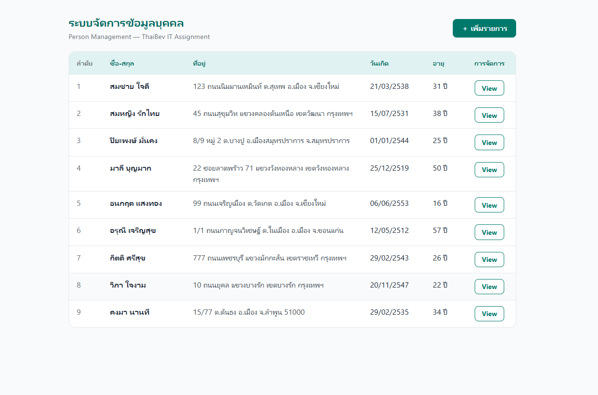
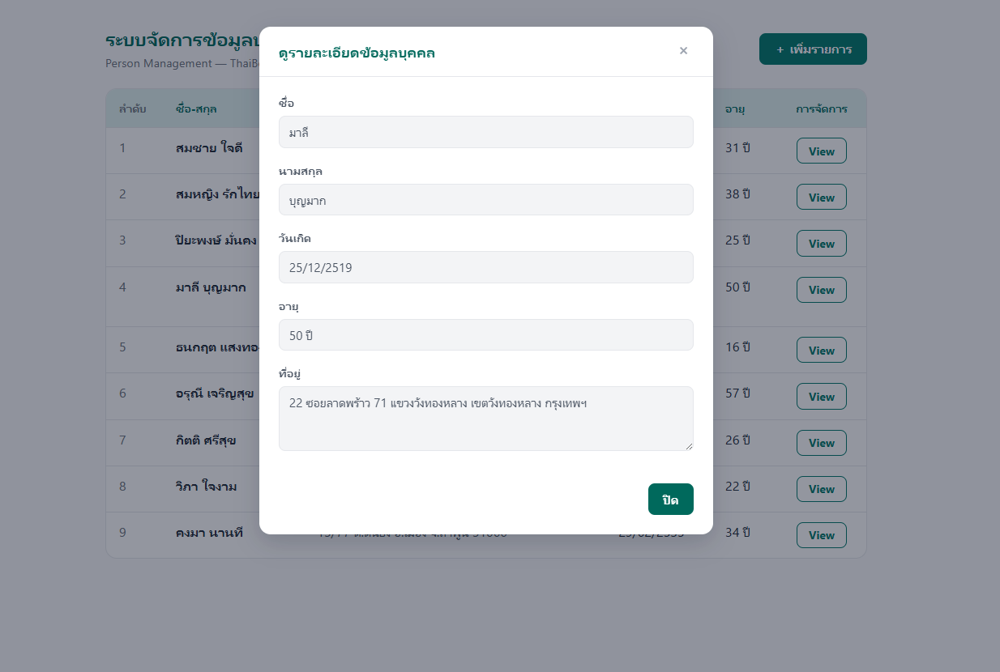

# ThaiBev IT Assignment — Person Management

ระบบจัดการข้อมูลบุคคล 3 หน้าจอ (IT 01-1 List, IT 01-2 Add modal, IT 01-3 View modal)
ตามโจทย์: อายุ = ปีปัจจุบัน − ปีเกิด และแสดงผล **ปี พ.ศ.**

**Stack:** SQL Server (Docker) · C# .NET 10 Web API (EF Core) · Vue 3 + TypeScript + Vite

```
thaibev-assignment/
├── .github/workflows/ci.yml        # CI: backend, frontend, DB startup + API smoke test
├── backend/
│   ├── ThaiBev.PersonApi/          # Web API
│   │   ├── Controllers/PersonsController.cs
│   │   ├── Services/               # PersonService, AgeCalculator, exception handler
│   │   ├── Data/                   # AppDbContext, DbInitializer (migration + seed)
│   │   ├── Entities/  Dtos/
│   │   ├── Migrations/             # EF migration (InitialCreate)
│   │   └── appsettings*.json       # dev มี connection string (dev-only) + production config
│   └── ThaiBev.PersonApi.Tests/    # xUnit: AgeCalculatorTests, PersonServiceTests
├── frontend/                       # Vue 3 + Vite + TS
│   └── src/
│       ├── api/personApi.ts        # axios client (/api → proxy ไป :5000)
│       ├── utils/buddhistDate.ts   # แปลง พ.ศ./ค.ศ., format dd/mm/yyyy พ.ศ., คำนวณอายุ
│       ├── components/             # PersonTable (01-1), PersonFormModal (01-2), PersonViewModal (01-3)
│       ├── composables/usePersons.ts
│       ├── views/PersonListView.vue
│       └── **/*.test.ts            # Vitest + Vue Test Utils
├── database/
│   ├── docker-compose.yml          # SQL Server 2022 (LOCAL DEV ONLY) — รหัสผ่านมาจาก env
│   ├── .env.example                # ตัวอย่าง env
│   ├── 01_create_schema.sql        # สร้าง DB + ตาราง Person (สำรองไว้ใช้นอกเหนือจาก EF migration)
│   └── 02_seed.sql                 # ข้อมูลตัวอย่าง 8 รายการ
├── docs/screenshots/               # ภาพหน้าจอ 3 รูป
└── LICENSE                         # MIT
```

## Screenshots

| IT 01-1 — หน้ารายการ | IT 01-2 — เพิ่มข้อมูล | IT 01-3 — ดูรายละเอียด |
|---|---|---|
|  |  |  |

## สิ่งที่ต้องติดตั้ง

| เครื่องมือ | เวอร์ชันที่ใช้พัฒนา |
| --- | --- |
| .NET SDK | 10.0 (`dotnet --list-sdks`) |
| Node.js | 24.x (npm 11) |
| SQL Server | ผ่าน Docker (`docker-compose`) |
| Docker Desktop | ใช้ Docker รัน SQL Server |

## Configuration (local dev)

> ⚠️ รหัส SQL Server ใน `appsettings.Development.json` เป็น **development-only**
> ห้ามใช้ชุดนี้บน production (production ใช้ managed database + `ConnectionStrings__Default` จาก secret manager)

## วิธีรัน (3 ส่วน)

### 1) SQL Server

```bash
cd database
cp .env.example .env          # Windows: Copy-Item .env.example .env
# แก้ .env ใส่ MSSQL_SA_PASSWORD ที่แข็งแรงของตัวเอง (อย่า commit .env)
docker compose up -d --wait   # รอจน healthcheck ผ่าน
docker compose ps
```

- `.env` ถูก ignore โดย git; ไฟล์ที่ commit มีเพียง `.env.example` (ค่า placeholder)
- เปลี่ยน host port ได้ด้วย `SQLSERVER_PORT` (ค่าเริ่มต้น `1433`)
- ถ้าเคยสร้าง volume ไว้ด้วยรหัสผ่านอื่น ให้ `docker compose down -v` เพื่อล้างข้อมูล local แล้ว `up` ใหม่
  (SQL Server จะใช้รหัสผ่านที่ตั้งไว้ตอนสร้าง volume ครั้งแรก; ข้อมูล local จะหาย)
- ถ้าใช้ SQL Server อื่น (LocalDB / Express / เครื่อง server) ข้ามขั้นตอนนี้ได้

### 2) Backend API

local dev **ไม่ต้องตั้งอะไรเพิ่ม** — connection string อยู่ใน `appsettings.Development.json` แล้ว

**รัน API:**

```bash
dotnet run
# → http://localhost:5000
# Swagger UI: http://localhost:5000/swagger (เฉพาะ Development)
```

ตอน startup API จะ:

1. Apply EF migration (`InitialCreate`) สร้าง DB + ตาราง `Person` ให้เอง — **ไม่ต้องรัน SQL script เอง**
   (ถ้าสร้างตารางจาก `database/01_create_schema.sql` ไปก่อนแล้ว API จะตรวจและข้าม migration ให้เอง)
2. Seed ข้อมูลตัวอย่าง 8 รายการ ถ้าตารางยังว่าง (ชุดเดียวกับ `database/02_seed.sql`)

**ทดสอบ API :**

```bash
curl http://localhost:5000/api/persons
```

### 3) Frontend

```bash
cd frontend
npm install
npm run dev
# → http://localhost:5173 (proxy /api → http://localhost:5000 ให้เอง)
```

## Production Deployment

- ตั้ง `ASPNETCORE_ENVIRONMENT=Production`
- ใส่ `ConnectionStrings__Default` จาก secret manager ของ platform (ไม่ใช่ไฟล์ config)
- กำหนด CORS ที่อนุญาตผ่าน `Cors__AllowedOrigins__0=https://your-frontend.example.com`
- Swagger ถูกปิดนอก Development อยู่แล้ว; 500 error ไม่ expose stack trace
- terminate TLS ที่ reverse proxy / ingress และอย่าเปิด SQL Server port สาธารณะ
- `appsettings.Production.json` ตั้ง log level แบบไม่ verbose และไม่มีข้อมูลลับ
- ก่อนใช้งานจริงกับข้อมูลบุคคลต้องเพิ่ม authentication/authorization, audit log และนโยบาย retention (ดูหัวข้อ Scope)

## การทำงานของระบบ

### เกี่ยวกับ ปี พ.ศ

- DB และ API จัดเก็บ/ส่งเป็น **ค.ศ.** รูปแบบ ISO `yyyy-MM-dd` (DATE / `DateOnly`) — ถูกต้องต่อการ sort และ validate
- แปลงเป็น พ.ศ. **เฉพาะที่ UI** (`frontend/src/utils/buddhistDate.ts`): แสดง `dd/mm/yyyy` พ.ศ. และ date picker (วันเกิดใน IT 01-2) แสดงเดือนไทย + ปี พ.ศ. ทั้ง header และช่อง input
- อายุ = ปีปัจจุบัน − ปีเกิด ตามโจทย์ (ไม่ใช่อายุเต็มปี) — คำนวณฝั่ง API ตอนอ่าน (`Services/AgeCalculator.cs`) ไม่เก็บลง DB
- เวลา "ปัจจุบัน" อ้าง timezone `Asia/Bangkok` ก่อนดึงปี เพื่อกันกรณี server เป็น UTC คืนวันที่ 31 ธ.ค.
- คอลัมน์ "ลำดับ" ในตารางแสดงลำดับแถว (1, 2, 3, …) ไม่ใช่ `Id` ของฐานข้อมูล

### API (base: `/api/persons`)

| Method | Path | คำอธิบาย | Response |
| --- | --- | --- | --- |
| GET | `/api/persons` | รายการทั้งหมด เรียง `Id ASC` (ข้อมูลใหม่อยู่ท้าย) | 200 `PersonListItem[]` |
| GET | `/api/persons/{id}` | รายละเอียดสำหรับ View modal | 200 `PersonDetail` / 404 |
| POST | `/api/persons` | เพิ่มข้อมูลใหม่ | 201 + `Location` header / 400 |

- Validation ทั้งจาก DataAnnotations ของ DTO และใน service (วันเกิดห้ามอนาคต / เก่าเกิน 150 ปี / trim ช่องว่าง) คืนเป็น `ValidationProblemDetails`
- Error ที่ไม่คาดคิดคืน 500 เป็น `ProblemDetails` โดยไม่เปิดเผย stack trace (global `IExceptionHandler`)

### UI พฤติกรรมสำคัญ

- **ยกเลิก / Esc / คลิกนอก modal** → ปิดโดยไม่เรียก API และไม่บันทึกอะไรลง DB เปิดใหม่ฟอร์มว่างเสมอ
- อายุใน Add modal ขึ้น `-- ปี` จนกว่าเลือกวันเกิด แล้วคำนวณสดทันที
- ปุ่ม บันทึก disable ระหว่างส่ง กันกดซ้ำเกิด 2 แถว
- View modal เป็น read-only ทุกช่อง (เรียก `GET /{id}` ทุกครั้งที่เปิด) มีเฉพาะปุ่ม ปิด
- มี loading / empty state ("ยังไม่มีข้อมูล") / error ภาษาไทยเมื่อ API ล้มเหลว พร้อมปุ่มลองใหม่

## Tests

**Backend (xUnit):**

```bash
cd backend
dotnet test   # 21 tests: AgeCalculator (leap day, edge case ขึ้นปีใหม่, พ.ศ.-ค.ศ.) + PersonService (validation, ordering, trim)
```

**Frontend (Vitest + Vue Test Utils):**

```bash
cd frontend
npm test          # run once (CI)
npm run test:watch
npm run typecheck # vue-tsc
```

## CI (GitHub Actions)

`.github/workflows/ci.yml` รันบน push/PR:

1. **Backend** — restore, build (Release), `dotnet test`
2. **Frontend** — `npm ci`, typecheck, Vitest, production build
3. **Database** — start SQL Server 2022 ด้วย Docker Compose (รหัสผ่านสุ่มเฉพาะ CI),
   build + start API, ตรวจ `GET /api/persons` ได้ข้อมูล seed, และเช็ก 404 / validation 400

## Scope / Security Notes

Assignment นี้เจตนาเน้น **List / Create / View** ตามโจทย์:

- **ไม่มี Authentication/Authorization** — ทุก endpoint เข้าถึงได้ถ้าเชื่อมถึง API
  ก่อน deploy จริงต้องเพิ่ม auth (เช่น OIDC/JWT) และจำกัดสิทธิ์ราย endpoint
- **ไม่มี Edit/Delete** — View เป็น read-only ตามโจทย์; ถ้าต้องการแก้ไข/ลบต้องเพิ่ม endpoint + สิทธิ์ + audit
- **ไม่มี Pagination/Filtering** — เหมาะกับข้อมูลน้อยของ assignment; ข้อมูลมากควรเพิ่ม paging/filter ฝั่ง API
- **Privacy/Retention** — ข้อมูลบุคคลเป็นข้อมูลอ่อนไหว ก่อนใช้จริงต้องกำหนดนโยบายเก็บรักษา,
  สิทธิ์เข้าถึง, audit log และกระบวนการลบ/ทำ anonymize ให้ชัดเจน
- `appsettings.Development.json` มีรหัส SQL Server แบบ **development-only** เพื่อให้รัน local ได้ง่าย;
  production ต้อง override ด้วย `ConnectionStrings__Default` จาก secret manager และห้ามใช้รหัสชุดนี้
- ห้ามใช้ `v-html` กับข้อมูลจาก user (XSS) — Vue escape ให้โดย default
- Vite proxy `/api` → `:5000` ใช้ใน dev เท่านั้น; API เปิด CORS ตาม origin ที่ตั้งใน config

## License

[MIT](LICENSE)
